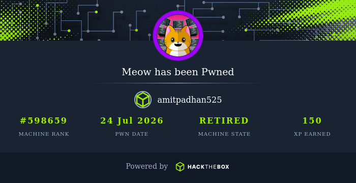
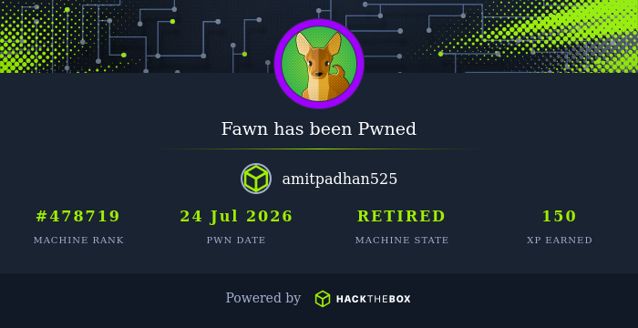
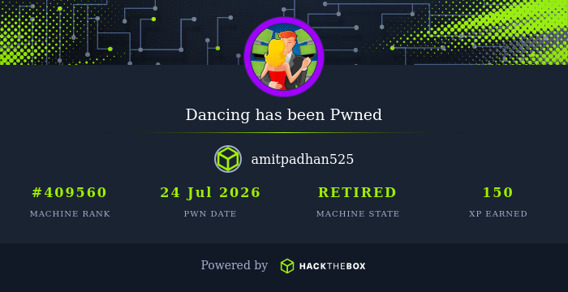
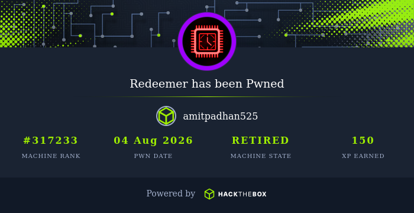
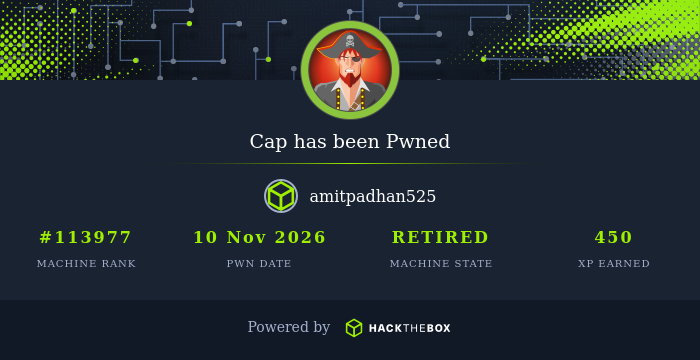
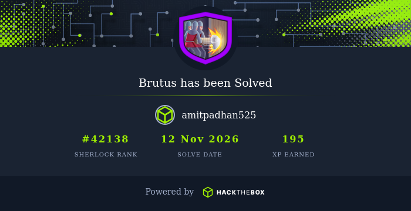
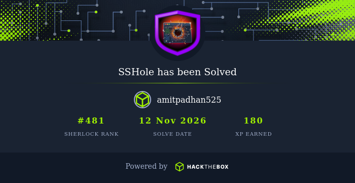
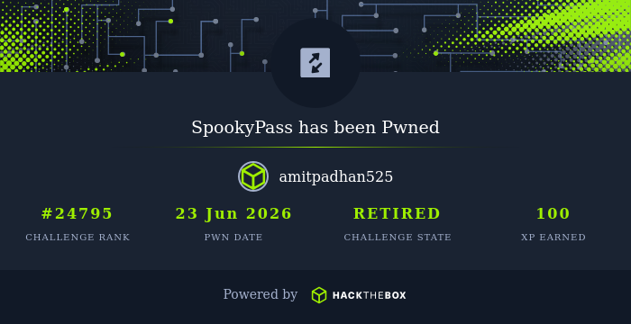
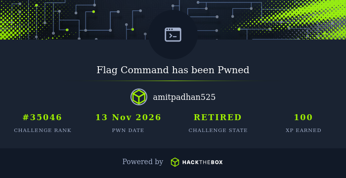

# 🏆 HackTheBox Achievements

Verified HackTheBox machine completions, Sherlocks, and CTF challenges solved by **[Amit Padhan](https://github.com/amitpadhan525)**.

---

## ===STARTING===

### 1. Meow
- **Type:** Starting Point Machine (Tier 0)
- **Achievement Link:** [https://labs.hackthebox.com/achievement/machine/2337402/394](https://labs.hackthebox.com/achievement/machine/2337402/394)
- **Preview:**

---

### 2. Fawn
- **Type:** Starting Point Machine (Tier 0)
- **Achievement Link:** [https://labs.hackthebox.com/achievement/machine/2337402/393](https://labs.hackthebox.com/achievement/machine/2337402/393)
- **Preview:**

---

### 3. Dancing
- **Type:** Starting Point Machine (Tier 0)
- **Achievement Link:** [https://labs.hackthebox.com/achievement/machine/2337402/395](https://labs.hackthebox.com/achievement/machine/2337402/395)
- **Preview:**

---

### 4. Redeemer
- **Type:** Starting Point Machine (Tier 0)
- **Achievement Link:** [https://labs.hackthebox.com/achievement/machine/2337402/472](https://labs.hackthebox.com/achievement/machine/2337402/472)
- **Preview:**

---

## ===MACHINE===

### Cap
- **Type:** Linux Machine
- **Achievement Link:** [https://labs.hackthebox.com/achievement/machine/2337402/351](https://labs.hackthebox.com/achievement/machine/2337402/351)
- **Preview:**

---

## ===SHERLOCKS===

### 1. Brutus
- **Type:** Defensive Security / DFIR Sherlock
- **Achievement Link:** [https://labs.hackthebox.com/achievement/sherlock/2337402/631](https://labs.hackthebox.com/achievement/sherlock/2337402/631)
- **Preview:**

---

### 2. SSHole
- **Type:** Defensive Security / DFIR Sherlock
- **Achievement Link:** [https://labs.hackthebox.com/achievement/sherlock/2337402/1947](https://labs.hackthebox.com/achievement/sherlock/2337402/1947)
- **Preview:**

---

## ===CHALLENGES===

### 1. SpookyPass
- **Type:** Security Challenge
- **Achievement Link:** [https://labs.hackthebox.com/achievement/challenge/2337402/806](https://labs.hackthebox.com/achievement/challenge/2337402/806)
- **Preview:**

---

### 2. Flag Command
- **Type:** Security Challenge
- **Achievement Link:** [https://labs.hackthebox.com/achievement/challenge/2337402/646](https://labs.hackthebox.com/achievement/challenge/2337402/646)
- **Preview:**

